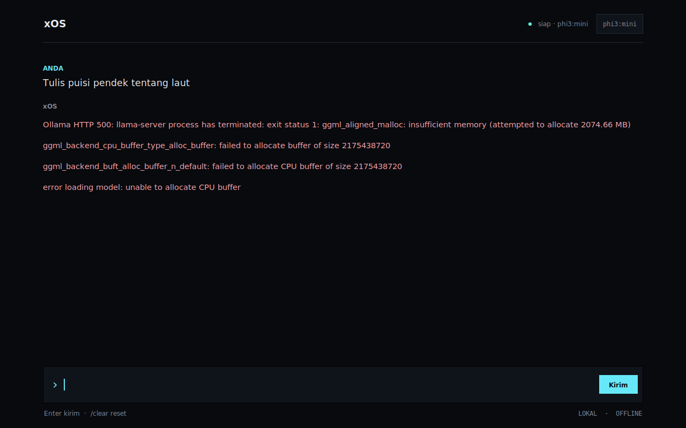

# xOS Alpha

> **Powered by [AIMB-X Labs](https://aimb-x.xyz)**

Prototype cognitive operating system: minimal Ubuntu, X11 + Openbox kiosk,
fullscreen Tkinter shell, and Ollama with models embedded directly inside
the ISO. No GNOME/KDE, no display manager, and no internet connection required at boot.

```
Ubuntu 24.04 VPS
└── debootstrap noble (minbase)
    ├── kernel 6.8 + casper + squashfs(zstd) + GRUB BIOS/UEFI
    ├── Xorg + Openbox (kiosk, no desktop environment)
    ├── Python 3 + Tkinter shell  (/opt/xos-shell/xos_shell.py)
    ├── Ollama systemd             (127.0.0.1:11434)
    └── model weights              (phi3:mini or llama3.1:8b)
                │
                ▼  mksquashfs + xorriso
          xos-alpha.iso
                │
                ▼  VirtualBox
 boot → casper → systemd → ollama + xos-seal → startx → openbox → xOS Shell
```

> **Important:** **xOS** is the product/prototype name. This system does not claim
> to be actual AGI. What runs is an offline, local language model.

## Live site

[](https://aimb-x.xyz)

The public site at [aimb-x.xyz](https://aimb-x.xyz) is built with Next.js,
Tailwind CSS, and Remotion.

---

## 1. Tech Stack Decisions

| Layer | Choice | Rationale |
|---|---|---|
| Base OS | **Ubuntu 24.04 LTS (noble) minimal via debootstrap** | Reproducible, headless, smoothest kernel/Xorg/Ollama support. Alpine is smaller, but musl + Ollama glibc + VirtualBox drivers add risk. |
| Live boot | **casper + squashfs + overlay RAM** | Native Ubuntu live boot path. No installer needed. Changes discarded on reboot (ideal for alpha). |
| Bootloader / ISO | **GRUB standalone + xorriso** | Hybrid BIOS + UEFI ISO, can exceed 4 GB, and can be built headless on a VPS. |
| Display | **Xorg + Openbox** | Lightweight, stable in VirtualBox, and Tkinter runs natively without XWayland. No GNOME/KDE/display manager. |
| Shell | **Python 3 + Tkinter (stdlib)** | No pip/npm dependencies, no WebKit/GPU needed, small footprint, HTTP API handled via stdlib `urllib`. CustomTkinter or Tauri can be considered later to polish the UI. |
| Inference | **Ollama, systemd, 127.0.0.1** | Single binary + systemd unit. Model baked into the image for complete offline operation. |
| Default model | **phi3:mini** | ~2.3 GB, performs comfortably on a VM with 6–8 GB RAM and 4 vCPUs. `llama3.1:8b` available as an option. |
| Voice | **Not included in alpha** | Offline STT/TTS adds 0.5–2 GB and audio complexity. Roadmap is in Section 5. |

### Why not Cubic / Linux Live Kit?

- **Cubic** is a GUI application; a headless VPS is not suited for it, and results are difficult to reproduce in CI.
- **Linux Live Kit** is simple, but its maintenance and UEFI/Ubuntu 24.04 compatibility are fragile.
- **debootstrap + casper + xorriso** provides full control and can run as a single script on a VPS. That is the approach used here.

### Why not Sway?

Sway + Wayland is more modern, but Tkinter would need XWayland, and VirtualBox graphics drivers (VMSVGA) have more issues under Wayland. For alpha, Xorg + Openbox offers the shortest path to a rock-solid kiosk screen. Sway can be an experimental branch once the base image boots reliably.

### Why not Tauri / Web?

Tauri / WebViews pull in WebKitGTK, web runtimes, and often rely on GPU acceleration. In VirtualBox VMs without Guest Additions, that introduces failure points. Tkinter is more than enough for an input bar + streaming text, with zero runtime dependencies beyond `python3-tk`.

---

## 2. Resource Requirements

### VPS Build Host

| Model | vCPU | RAM | Disk | Estimated ISO |
|---|---:|---:|---:|---:|
| `phi3:mini` | 4 | 8 GB | 30–40 GB | 4–5 GB |
| `llama3.1:8b` | 4–8 | 8–16 GB | 50–60 GB | 7–9 GB |

The build process does not run heavy inference, but `debootstrap`, `apt`, and `mksquashfs` require disk space. Set `NEED_GB=24` or higher for the 8B model.

### VirtualBox VM

| Model | VM RAM | vCPU | Video | Notes |
|---|---:|---:|---|---|
| `phi3:mini` | 6–8 GB | 4 | VMSVGA, 128 MB, 3D off | Minimum realistic is 4 GB, but 6–8 GB is safer |
| `llama3.1:8b` | 10–12 GB | 4–8 | VMSVGA, 128 MB, 3D off | Requires sufficient host RAM |

The ISO is a live image; no large virtual disk is required. VirtualBox requires creating a disk during VM setup, but an unused 8–16 GB disk is fine.

---

## 3. Quick Build

On an Ubuntu 24.04 VPS:

```bash
# 1. Copy project to VPS
scp -r xos root@VPS_IP:/root/

# 2. Connect and install host dependencies
ssh root@VPS_IP
cd /root/xos
sudo ./build.sh host

# 3. Full build (bootstrap + provisioning + model + ISO)
# If KIOSK_USER or XOS_PASSWORD is not provided in env, the script prompts interactively:
sudo ./build.sh all

# Or provide credentials upfront via environment variables:
sudo KIOSK_USER=xos XOS_PASSWORD='change-this-password' ./build.sh all

# 4. Output
ls -lh dist/xos-alpha.iso dist/xos-alpha.iso.sha256
```

The initial build downloads Ubuntu packages, the Ollama binary, and model weights. Typical build time is 20–60 minutes depending on network speed and CPU cores.

### Important Build Options

```bash
# Build with Llama 3.1 8B (requires more RAM and disk)
sudo MODEL=llama3.1:8b XOS_PASSWORD='...' NEED_GB=24 ./build.sh all

# Test boot/ISO first without downloading model weights
sudo SKIP_MODEL_PULL=1 ./build.sh all

# Re-bootstrap from scratch
sudo FORCE_ROOTFS=1 ./build.sh all

# After editing shell/config: re-provision and repack ISO
sudo ./build.sh rootfs
sudo ./build.sh iso

# Clean up build tree and artifacts
sudo ./build.sh clean
```

`XOS_PASSWORD` must not contain `:` or newline characters. Change the default `xos` password before distributing images.

### Build Stages (`build.sh`)

1. **host** — Installs `debootstrap`, `squashfs-tools`, `xorriso`, `grub-pc-bin`, `grub-efi-amd64-bin`, `mtools`, and `dosfstools`.
2. **rootfs** — Runs `debootstrap --variant=minbase noble`, bind-mounts `/dev`, `/dev/pts`, `/proc`, `/sys`, `/run`, and enters chroot.
3. **provision** — Installs the kernel, casper, Xorg, Openbox, Tkinter, Python 3, creates user `xos`, installs systemd units, and downloads Ollama and model weights.
4. **initramfs** — Runs `update-initramfs -u -k all` to include casper hooks.
5. **iso** — Generates `mksquashfs` rootfs, builds GRUB BIOS/EFI standalone images, and invokes `xorriso` to create a hybrid ISO.

File tree:

```text
xos/
├── build.sh                  # Host build orchestrator
├── config/
│   ├── xos-kiosk.service     # startx + Openbox + kiosk shell unit
│   ├── xos-seal.service      # Locks live user after casper runs
│   ├── xos-seal.sh
│   ├── xos-shell.env         # Model, endpoint, parameters
│   ├── casper.conf
│   ├── grub.cfg
│   ├── ollama.service
│   ├── system-prompt.txt
│   └── xinitrc
├── shell/xos_shell.py        # Tkinter kiosk application
├── tools/
│   ├── provision.sh          # Executed inside the chroot
│   └── mock_ollama.py        # Mock Ollama server for UI testing
└── dist/                     # ISO build output
```

---

## 4. Configuration

### Model

`MODEL` specified during build is written to `/etc/xos/xos-shell.env`:

```ini
XOS_OLLAMA_URL=http://127.0.0.1:11434
XOS_MODEL=phi3:mini
XOS_LANGUAGE=en
XOS_NUM_CTX=4096
XOS_NUM_PREDICT=768
XOS_TEMPERATURE=0.4
XOS_ALLOW_QUIT=0
XOS_SYSTEM_PROMPT_FILE=/etc/xos/system-prompt.txt
XOS_LOG_LEVEL=INFO
```

For 8B models, `XOS_NUM_CTX=8192` can be used if RAM allows. Avoid increasing `NUM_CTX` without adequate RAM.

### System Prompt

Edit `config/system-prompt.txt`, then rebuild:

```bash
sudo ./build.sh rootfs && sudo ./build.sh iso
```

### Language

Default UI language is **English** (`XOS_LANGUAGE=en`). Inside the shell:

```text
/language          # Show active language and available options
/language id       # Switch UI + response default to Indonesian
/language en       # Switch back to English
```

The model adapts to whichever language the user types in. To add additional languages, add the locale code and translations to `SUPPORTED_LANGUAGES` and `STRINGS` in `shell/xos_shell.py`; untranslated keys fall back to English automatically.

### Debug Password

The alpha uses an `xos` user account with password defined by `XOS_PASSWORD`. Casper sets up a passwordless live user with passwordless sudo on every boot; `xos-seal.service` removes Casper's sudoers configuration and restores the known password before the kiosk starts. This is an alpha configuration, **not** production security hardening.

Debug console access: `Ctrl+Alt+F2` (in VirtualBox, `Host+F2`), log in as `xos` + password, then press `Ctrl+Alt+F1` to return to the kiosk shell.

### Model Licensing

- `phi3:mini` — MIT license (retain notice).
- `llama3.1:8b` — Llama 3.1 Community License. Distributing ISOs containing model weights must comply with their respective terms. Review licenses before public distribution.

---

## 5. xOS Shell

`shell/xos_shell.py` is a dependency-free Tkinter application:

- Fullscreen, dark theme, input bar, Ollama status indicator, model chip.
- Non-blocking token streaming from `POST /api/chat` (NDJSON).
- Dedicated worker thread + `queue.Queue`; Tkinter main loop remains responsive.
- Multilingual UI: **English (default)** and Indonesian. Switch on the fly with `/language id` or `/language en`; `XOS_LANGUAGE` sets the boot default.
- Enter sends, `Esc` stops generation or clears the input line.
- `/clear` cancels in-flight generation and resets conversation context.
- Conversation history is capped to ~16 messages / 12k characters to avoid context overflow.
- `keep_alive: 30m`, `num_ctx`, `num_predict`, and temperature configurable via environment variables.
- Clear error handling for missing models, HTTP errors, and connection timeouts without application crash.

### Shell Commands

| Command | Description |
|---|---|
| `/help` | Show all available commands |
| `/clear` | Clear chat history and cancel in-flight generation |
| `/model` | Show current active model and status |
| `/models` | List all installed models with sizes |
| `/model switch <name>` | Switch active model (fuzzy match by name) |
| `/model pull <name>` | Pull/download a new model from Ollama registry |
| `/model rm <name>` | Remove an installed model |
| `/language` | Show active language and available options |
| `/language en` | Switch UI to English |
| `/language id` | Switch UI to Indonesian |

> [!NOTE]
> Model operations run in background daemon threads — the UI remains responsive during long pulls.
> If the active model is deleted, xOS automatically switches to the next available model.
> `/model switch` and `/model rm` use fuzzy name matching (e.g. `phi3` matches `phi3:mini`).

### UI Smoke Test (Development / VPS)

Requires `python3-tk`, `Xvfb` (optional for headless), or local display:

```bash
# Terminal 1 — Run mock Ollama server on port 11435
# Supports: GET /api/tags, POST /api/chat, POST /api/pull, DELETE /api/delete
MOCK_PORT=11435 python3 tools/mock_ollama.py

# Terminal 2 — Run shell in windowed mode
XOS_OLLAMA_URL=http://127.0.0.1:11435 \
XOS_WINDOWED=1 \
XOS_ALLOW_QUIT=1 \
python3 shell/xos_shell.py
```

On headless VPS (no `DISPLAY`), prefix with `xvfb-run -a`:

```bash
# Headless: start both in one shot
xvfb-run -a bash -c '
  MOCK_PORT=11435 python3 tools/mock_ollama.py &
  sleep 0.5
  XOS_OLLAMA_URL=http://127.0.0.1:11435 XOS_WINDOWED=1 XOS_ALLOW_QUIT=1 python3 shell/xos_shell.py
'
```

Inside the ISO image, the shell is started automatically:

```text
xos-kiosk.service
  └─ /usr/bin/startx -- :0 vt1 -keeptty -nolisten tcp
       └─ ~/.xinitrc
            ├─ xset / xrandr / unclutter
            ├─ openbox --sm-disable
            └─ exec /usr/local/bin/xos-shell
                 └─ python3 /opt/xos-shell/xos_shell.py
```

`startx` runs in the foreground; if the shell exits, X shuts down and systemd restarts the session. This keeps the kiosk crash-resilient without a display manager.

### Voice Integration (Roadmap)

The alpha is text-only. The next phase can add `alsa-utils` + `whisper.cpp` (lightweight multilingual model) + `piper`/`espeak-ng`:

```text
Push-to-talk button
  → arecord -f S16_LE -r 16000 -c 1
  → whisper.cpp (offline STT)
  → populate Entry / send directly to Ollama
  → optional Piper TTS
```

Always-listening wake words should not be introduced without careful privacy design, microphone status indicators, and physical/software mute switches.

---

## 6. Testing in VirtualBox

### Creating the VM (CLI example)

```bash
VBoxManage createvm --name xOS --ostype Ubuntu_64 --register
VBoxManage modifyvm xOS \
  --memory 8192 --cpus 4 --vram 128 \
  --graphicscontroller vmsvga --accelerate3d off \
  --audio none --nic1 nat \
  --boot1 dvd --boot2 disk --boot3 none --boot4 none
VBoxManage storagectl xOS --name SATA --add sata --controller IntelAhci
VBoxManage storageattach xOS --storagectl SATA --port 0 --device 0 \
  --type dvddrive --medium /path/xos-alpha.iso
VBoxManage startvm xOS
```

If using UEFI:

```bash
VBoxManage modifyvm xOS --firmware efi
```

Disable Secure Boot in the VM. The GRUB build in this image is unsigned. If UEFI encounter issues, stick to default BIOS.

### Expected Behavior

1. GRUB boots, select **xOS alpha**.
2. Kernel + casper mounts squashfs, systemd initializes.
3. Dark kiosk screen appears with input prompt.
4. Top-right status chip changes to `ready · phi3:mini` after health check succeeds.
5. Type query, press Enter; response streams token by token.
6. No network connection; Ollama communicates only on loopback.
7. Reboot resets the machine back to clean state (RAM overlay).

### QEMU Validation (23 Oct 2026)

The generated `dist/xos-alpha.iso` was booted from the ISO in both firmware
modes under QEMU TCG:

| Mode | Firmware | Result |
|---|---|---|
| BIOS | i440fx, 2 GB RAM, 2 vCPU | GRUB -> casper -> xOS kiosk |
| UEFI | q35 + OVMF, Secure Boot off, 2 GB RAM, 2 vCPU | GRUB -> casper -> xOS kiosk |

SHA-256 of the validated image:

```text
fc66ff1408a993dda7db94d25ea3abb68125894e772f0a0580cb62a10403c425  xos-alpha.iso
```

| English default (BIOS) | Bahasa Indonesia (`/language id`) |
|---|---|
|  |  |

| Stop with `Esc` | English default (UEFI) |
|---|---|
|  |  |

The stop path was verified with a live request: status changed to
`dihentikan` and input focus returned immediately. Full token generation was
not validated inside the 2 GB TCG guest because `phi3:mini` needs roughly
2.2 GB just for weights. Use the 8 GB VirtualBox configuration for inference
testing. Under QEMU TCG the first Xorg launch can also fail while the
emulated VGA device is still initializing; `xos-kiosk.service` restarts and
the kiosk appeared on the third attempt.

### Debugging

```text
Ctrl+Alt+F2 (Host+F2)
login: xos
password: <XOS_PASSWORD>
```

```bash
journalctl -u xos-kiosk -b --no-pager
journalctl -u ollama -b --no-pager
systemctl status ollama xos-seal xos-kiosk
ollama list
curl -s http://127.0.0.1:11434/api/tags
cat /home/xos/.local/share/xorg/Xorg.0.log 2>/dev/null || \
  cat /var/log/Xorg.0.log
```

Return to the kiosk shell with `Ctrl+Alt+F1`.

---

## 7. Troubleshooting

| Symptom | Common Cause | Action |
|---|---|---|
| ISO does not boot | VirtualBox has UEFI + Secure Boot enabled, or ISO is not attached as CD/DVD | Try BIOS, disable Secure Boot, verify with `VBoxManage showvminfo` |
| `Unable to find a medium containing a live file system` | `boot=casper` cannot locate `/casper/filesystem.squashfs` | Inspect ISO content (`xorriso -indev ... -ls /casper`), rebuild, verify `casper` is installed and initramfs regenerated |
| Black screen after GRUB | Xorg failure / VirtualBox display driver | Check Xorg log; test `nomodeset` in debug boot entry; set VMSVGA 128 MB with 3D acceleration off |
| Kiosk restarts in a loop | `xos-kiosk.service` failed to start X | Run `journalctl -u xos-kiosk -b`; test `startx` manually as `xos` user |
| `ollama offline` | Ollama service not running / wrong socket | Check `systemctl status ollama`; verify `OLLAMA_HOST=127.0.0.1:11434` |
| `model ... not found` | Model was not pulled or env mismatch | Run `ollama list`; verify `/etc/xos/xos-shell.env`; rebuild with matching `MODEL=` |
| Inference is extremely slow | CPU-only, model too large, or insufficient RAM | Use `phi3:mini`; assign more vCPUs/RAM; lower `NUM_CTX`/`NUM_PREDICT` |
| OOM / VM freeze | 8B model running on 4–6 GB RAM | Increase VM RAM or switch back to Phi-3 |
| No audio | Audio/voice packages not installed | By design for the alpha release |
| No internet in VM | No network manager installed | By design; Ollama runs locally. Add NetworkManager only if remote access is required |

---

## 8. Security & Alpha Limitations

- **Default live user password is `xos`** and stored in root-only configuration in the ISO. Always change it using `XOS_PASSWORD`. This is a prototype setup, not a hardened production OS.
- Casper creates a passwordless live user with passwordless sudo on boot. `xos-seal.service` strips Casper's sudoers configuration and resets the password before launching the kiosk, but a brief window exists during boot. Do not deploy this image on untrusted networks.
- Ollama listens strictly on `127.0.0.1`; no API port is exposed to the local network.
- No auto-updates, persistent user storage, full disk encryption, or signed boot. The ISO is an immutable snapshot.
- Model weights are bundled inside the ISO. Review license compliance before distribution.
- The shell does not perform HTML rendering, but model outputs may still contain inaccuracies. Always recommend human verification for safety-critical tasks.
- For production: implement signed GRUB/shim + Secure Boot, verified read-only rootfs (dm-verity), remove debug TTYs, strip sudo, patch Casper user initialization, audit networking, and implement an A/B partition update scheme.

---

## 9. Daily Commands

```bash
# Rebuild rootfs and repack ISO after configuration/shell edits
sudo ./build.sh rootfs
sudo ./build.sh iso

# Syntax validation check
bash -n build.sh tools/provision.sh config/xos-seal.sh config/xinitrc
python3 -m py_compile shell/xos_shell.py

# Inspect ISO layout
xorriso -indev dist/xos-alpha.iso -ls /casper

# Download to local workstation
scp root@VPS_IP:/root/xos/dist/xos-alpha.iso .

# Verify checksum
sha256sum -c xos-alpha.iso.sha256
```


---

<p align="center">
  <strong>Powered by AIMB-X Labs</strong><br>
  <sub>xOS Alpha · Cognitive Offline AI Kiosk OS · MIT License</sub>
</p>
