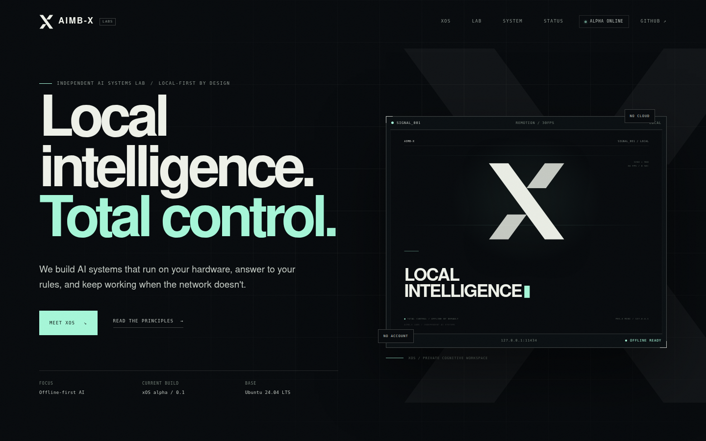
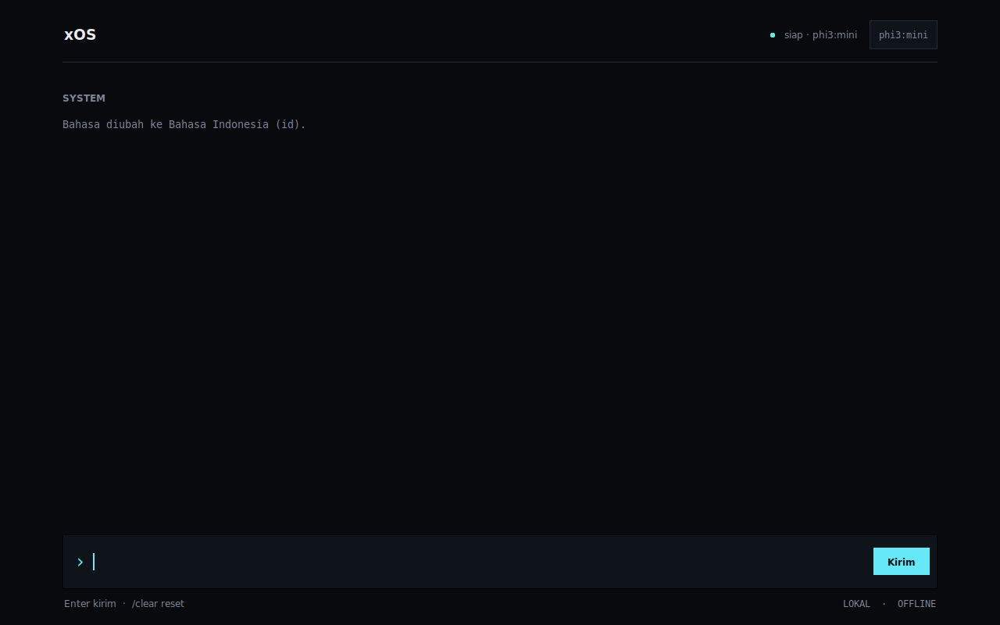

# xOS Alpha

> **Powered by [AIMB-X Labs](https://aimb-x.xyz)**

Prototype cognitive operating system: minimal Ubuntu, a **console TUI kiosk**
(curses on `tty1`, no X11, no display server), and Ollama with models embedded
directly inside the ISO. No GNOME/KDE, no display manager, and no internet
connection required at boot.

```
Ubuntu 24.04 VPS
└── debootstrap noble (minbase)
    ├── kernel 6.8 + casper + squashfs(zstd) + GRUB BIOS/UEFI
    ├── Python 3 + curses shell  (/opt/xos-shell/xos_shell.py)
    ├── Ollama systemd             (127.0.0.1:11434)
    └── model weights              (phi3:mini or llama3.1:8b)
                │
                ▼  mksquashfs + xorriso
          xos-alpha.iso
                │
                ▼  VirtualBox / QEMU
 boot → casper → systemd → ollama + xos-seal → xos-kiosk (tty1) → xOS Shell
```

> **Important:** **xOS** is the product/prototype name. This system does not claim
> to be actual AGI. What runs is an offline, local language model.

## Live site

[](https://aimb-x.xyz)

The public site at [aimb-x.xyz](https://aimb-x.xyz) is built with Next.js,
Tailwind CSS, and Remotion.

---

## 1. Tech Stack Decisions

| Layer | Choice | Rationale |
|---|---|---|
| Base OS | **Ubuntu 24.04 LTS (noble) minimal via debootstrap** | Reproducible, headless, smoothest kernel/Ollama support. Alpine is smaller, but musl + Ollama glibc + VirtualBox drivers add risk. |
| Live boot | **casper + squashfs + overlay RAM** | Native Ubuntu live boot path. No installer needed. Changes discarded on reboot (ideal for alpha). |
| Bootloader / ISO | **GRUB standalone + xorriso** | Hybrid BIOS + UEFI ISO, can exceed 4 GB, and can be built headless on a VPS. |
| Display | **Linux console + Terminus font** | No Xorg, Wayland, Openbox, or display manager to install, patch, or crash. Fewer moving parts and a smaller attack surface. |
| Shell | **Python 3 + curses (stdlib)** | No pip/npm dependencies, no WebKit/GPU needed, small footprint, HTTP API handled via stdlib `urllib`. Runs directly on `tty1` via systemd. |
| Inference | **Ollama, systemd, 127.0.0.1** | Single binary + systemd unit. Model baked into the image for complete offline operation. |
| Default model | **phi3:mini** | ~2.3 GB, performs comfortably on a VM with 6–8 GB RAM and 4 vCPUs. `llama3.1:8b` available as an option. |
| Voice | **Not included in alpha** | Offline STT/TTS adds 0.5–2 GB and audio complexity. Roadmap is in Section 5. |

### Why not Cubic / Linux Live Kit?

- **Cubic** is a GUI application; a headless VPS is not suited for it, and results are difficult to reproduce in CI.
- **Linux Live Kit** is simple, but its maintenance and UEFI/Ubuntu 24.04 compatibility are fragile.
- **debootstrap + casper + xorriso** provides full control and can run as a single script on a VPS. That is the approach used here.

### Why not Xorg + a GUI toolkit?

An X11 stack (Xorg + Openbox + Tkinter/Qt/GTK) adds hundreds of packages, a
display server that can fail independently of the app, and a large attack
surface — for a screen that only needs text. The console TUI renders with
curses and the kernel's built-in framebuffer console, so there is no display
server to crash and nothing to restart but the shell itself.

### Why not Tauri / Web?

Tauri / WebViews pull in WebKitGTK, web runtimes, and often rely on GPU acceleration. In VMs without Guest Additions, that introduces failure points. A curses UI is more than enough for an input bar + streaming text, with zero runtime dependencies beyond `python3`.

---

## 2. Resource Requirements

### VPS Build Host

| Model | vCPU | RAM | Disk | Estimated ISO |
|---|---:|---:|---:|---:|
| `phi3:mini` | 4 | 8 GB | 30–40 GB | 4–5 GB |
| `llama3.1:8b` | 4–8 | 8–16 GB | 50–60 GB | 7–9 GB |

The build process does not run heavy inference, but `debootstrap`, `apt`, and `mksquashfs` require disk space. Set `NEED_GB=24` or higher for the 8B model.

### VirtualBox VM

| Model | VM RAM | vCPU | Video | Notes |
|---|---:|---:|---|---|
| `phi3:mini` | 6–8 GB | 4 | VMSVGA, 128 MB, 3D off | Minimum realistic is 4 GB, but 6–8 GB is safer |
| `llama3.1:8b` | 10–12 GB | 4–8 | VMSVGA, 128 MB, 3D off | Requires sufficient host RAM |

The ISO is a live image; no large virtual disk is required. VirtualBox requires creating a disk during VM setup, but an unused 8–16 GB disk is fine.

---

## 3. Quick Build

On an Ubuntu 24.04 VPS:

```bash
# 1. Copy project to VPS
scp -r xos root@VPS_IP:/root/

# 2. Connect and install host dependencies
ssh root@VPS_IP
cd /root/xos
sudo ./build.sh host

# 3. Full build (bootstrap + provisioning + model + ISO)
# If KIOSK_USER or XOS_PASSWORD is not provided in env, the script prompts interactively:
sudo ./build.sh all

# Or provide credentials upfront via environment variables:
sudo KIOSK_USER=xos XOS_PASSWORD='change-this-password' ./build.sh all

# 4. Output
ls -lh dist/xos-alpha.iso dist/xos-alpha.iso.sha256
```

The initial build downloads Ubuntu packages, the Ollama binary, and model weights. Typical build time is 20–60 minutes depending on network speed and CPU cores.

### Important Build Options

```bash
# Build with Llama 3.1 8B (requires more RAM and disk)
sudo MODEL=llama3.1:8b XOS_PASSWORD='...' NEED_GB=24 ./build.sh all

# Test boot/ISO first without downloading model weights
sudo SKIP_MODEL_PULL=1 ./build.sh all

# Re-bootstrap from scratch
sudo FORCE_ROOTFS=1 ./build.sh all

# After editing shell/config: re-provision and repack ISO
sudo ./build.sh rootfs
sudo ./build.sh iso

# Clean up build tree and artifacts
sudo ./build.sh clean
```

`XOS_PASSWORD` is **required** and must not contain `:` or newline characters.
There is no default password. The kiosk account is not left with a known
credential: at boot `xos-seal.sh` installs an unguessable random password unless
the image was built with `XOS_DEBUG_CONSOLE=1` (see Section 4).

### Build Stages (`build.sh`)

1. **host** — Installs `debootstrap`, `squashfs-tools`, `xorriso`, `grub-pc-bin`, `grub-efi-amd64-bin`, `mtools`, and `dosfstools`.
2. **rootfs** — Runs `debootstrap --variant=minbase noble`, bind-mounts `/dev`, `/dev/pts`, `/proc`, `/sys`, `/run`, and enters chroot.
3. **provision** — Installs the kernel, casper, Python 3, console fonts, creates user `xos` (no sudo), installs systemd units, and downloads Ollama and model weights.
4. **initramfs** — Runs `update-initramfs -u -k all` to include casper hooks.
5. **iso** — Generates `mksquashfs` rootfs, builds GRUB BIOS/EFI standalone images, and invokes `xorriso` to create a hybrid ISO.

File tree:

```text
xos/
├── build.sh                  # Host build orchestrator
├── config/
│   ├── xos-kiosk.service     # curses shell unit on tty1
│   ├── xos-seal.service      # Removes Casper sudoers, randomises password
│   ├── xos-seal.sh
│   ├── xos-shell.env         # Model, endpoint, parameters
│   ├── casper.conf
│   ├── grub.cfg
│   ├── ollama.service
│   └── system-prompt.txt
├── shell/xos_shell.py        # curses kiosk application
├── tests/                    # Unit, regression, client and PTY E2E tests
├── tools/
│   ├── provision.sh          # Executed inside the chroot
│   ├── mock_ollama.py        # Mock Ollama server for UI testing
│   ├── ci_check.sh           # Local CI runner
│   └── static_check.py       # Stdlib-only static analysis
├── .github/workflows/ci.yml  # PR checks (lightweight only)
└── dist/                     # ISO build output
```

---

## 4. Configuration

### Model

`MODEL` specified during build is written to `/etc/xos/xos-shell.env`:

```ini
XOS_OLLAMA_URL=http://127.0.0.1:11434
XOS_STRICT_LOCAL=1
XOS_MODEL=phi3:mini
XOS_LANGUAGE=en
XOS_NUM_CTX=4096
XOS_NUM_PREDICT=768
XOS_TEMPERATURE=0.4
XOS_ALLOW_QUIT=0
XOS_SYSTEM_PROMPT_FILE=/etc/xos/system-prompt.txt
XOS_LOG_LEVEL=INFO
```

For 8B models, `XOS_NUM_CTX=8192` can be used if RAM allows. Avoid increasing `NUM_CTX` without adequate RAM.

### System Prompt

Edit `config/system-prompt.txt`, then rebuild:

```bash
sudo ./build.sh rootfs && sudo ./build.sh iso
```

### Language

Default UI language is **English** (`XOS_LANGUAGE=en`). Inside the shell:

```text
/language          # Show active language and available options
/language id       # Switch UI + response default to Indonesian
/language en       # Switch back to English
```

The model adapts to whichever language the user types in. To add additional languages, add the locale code and translations to `SUPPORTED_LANGUAGES` and `STRINGS` in `shell/xos_shell.py`; untranslated keys fall back to English automatically.

### Debug Console & Password

`XOS_PASSWORD` is mandatory at build time, but it is **not** shipped in the
image. At boot `xos-seal.service`:

1. removes Casper's passwordless-sudo drop-in (`/etc/sudoers.d/casper`), and
2. installs an unguessable random password for `xos` (or restores the
   build-time password if `/etc/xos/alpha-password` is non-empty).

The account is deliberately **not** locked with `passwd -l`, because
`xos-kiosk.service` runs with `PAMName=login` and some PAM account stacks reject
locked accounts, which would stop the shell from starting.

Console login is therefore disabled by default. To build a debuggable image,
opt in explicitly:

```bash
sudo XOS_DEBUG_CONSOLE=1 XOS_PASSWORD='debug-only' ./build.sh all
```

That writes the password to `/etc/xos/alpha-password` (mode 0600) inside the
image. **Do not distribute an image built this way.** With a debug image you can
switch to `Ctrl+Alt+F2` (VirtualBox: `Host+F2`), log in as `xos`, and return with
`Ctrl+Alt+F1`.

### Model Licensing

- `phi3:mini` — MIT license for the model weights (retain notice). The xOS
  project itself is proprietary; see `LICENSE`.
- `llama3.1:8b` — Llama 3.1 Community License. Distributing ISOs containing model weights must comply with their respective terms. Review licenses before public distribution.

---

## 5. xOS Shell

`shell/xos_shell.py` is a dependency-free **curses** application that renders on
the Linux console:

- Full-screen dark TUI with a sidebar (status, model, clock) and a scrolling transcript.
- Non-blocking token streaming from `POST /api/chat` (NDJSON) while the clock and input stay live.
- Dedicated worker thread + `queue.Queue`; the UI loop never blocks on the network.
- Multilingual UI: **English (default)** and Indonesian. Switch on the fly with `/language id` or `/language en`; `XOS_LANGUAGE` sets the boot default.
- Enter sends, `Esc` stops generation or clears the input line.
- `/clear` cancels in-flight generation and resets conversation context.
- Conversation history is capped to ~16 messages / 12k characters to avoid context overflow.
- `keep_alive: 30m`, `num_ctx`, `num_predict`, and temperature configurable via environment variables.
- Clear error handling for missing models, HTTP errors, and connection timeouts without application crash.
- **Strict-local mode** (`XOS_STRICT_LOCAL=1`, the default) refuses any non-loopback Ollama endpoint before a request is made.

### Shell Commands

| Command | Description |
|---|---|
| `/help` | Show all available commands |
| `/clear` | Clear chat history and cancel in-flight generation |
| `/model` | Show current active model and status |
| `/models` | List all installed models with sizes |
| `/model switch <name>` | Switch active model (fuzzy match by name) |
| `/model pull <name>` | Pull/download a new model from Ollama registry |
| `/model rm <name>` | Remove an installed model |
| `/language` | Show active language and available options |
| `/language en` | Switch UI to English |
| `/language id` | Switch UI to Indonesian |

> [!NOTE]
> Model operations run in background daemon threads — the UI remains responsive during long pulls.
> If the active model is deleted, xOS automatically switches to the next available model.
> `/model switch` and `/model rm` use fuzzy name matching (e.g. `phi3` matches `phi3:mini`).

### Testing (Development / VPS)

The shell needs a real TTY, but the test suite does not. Run everything with:

```bash
./tools/ci_check.sh
```

That executes, in order:

| Stage | What it proves |
|---|---|
| Shell syntax | `bash -n` on every shell file (checked individually) |
| Python syntax | `py_compile` on every Python file |
| Static analysis | `tools/static_check.py` (unused imports, bare `except`, `eval`/`exec`, mutable defaults) |
| Headless render | `python3 shell/xos_shell.py --selftest` |
| Logic tests | `tests/test_shell_logic.py` (4 tests) |
| Regression tests | `tests/test_regressions.py` (5 tests) |
| Ollama client | `tests/test_ollama_client.py` (15 tests against `tools/mock_ollama.py`) |
| TUI E2E | `tests/test_tui_e2e.py` (6 tests, real PTY, mock server) |

No model download and no network access are required. To drive the TUI by hand:

```bash
# Terminal 1 — mock Ollama on port 11435
MOCK_PORT=11435 python3 tools/mock_ollama.py

# Terminal 2 — run the TUI in a real terminal
XOS_OLLAMA_URL=http://127.0.0.1:11435 XOS_ALLOW_QUIT=1 python3 shell/xos_shell.py
```

Inside the ISO image the shell is started automatically on `tty1`:

```text
xos-kiosk.service (User=xos, TTYPath=/dev/tty1, PAMName=login)
  └─ /usr/local/bin/xos-shell
       └─ python3 /opt/xos-shell/xos_shell.py
```

systemd restarts the unit with `Restart=always` if the shell exits, so the kiosk
recovers from a crash without a display manager.

### Voice Integration (Roadmap)

The alpha is text-only. The next phase can add `alsa-utils` + `whisper.cpp` (lightweight multilingual model) + `piper`/`espeak-ng`:

```text
Push-to-talk button
  → arecord -f S16_LE -r 16000 -c 1
  → whisper.cpp (offline STT)
  → populate Entry / send directly to Ollama
  → optional Piper TTS
```

Always-listening wake words should not be introduced without careful privacy design, microphone status indicators, and physical/software mute switches.

---

## 6. Testing in VirtualBox

### Creating the VM (CLI example)

```bash
VBoxManage createvm --name xOS --ostype Ubuntu_64 --register
VBoxManage modifyvm xOS \
  --memory 8192 --cpus 4 --vram 128 \
  --graphicscontroller vmsvga --accelerate3d off \
  --audio none --nic1 nat \
  --boot1 dvd --boot2 disk --boot3 none --boot4 none
VBoxManage storagectl xOS --name SATA --add sata --controller IntelAhci
VBoxManage storageattach xOS --storagectl SATA --port 0 --device 0 \
  --type dvddrive --medium /path/xos-alpha.iso
VBoxManage startvm xOS
```

If using UEFI:

```bash
VBoxManage modifyvm xOS --firmware efi
```

Disable Secure Boot in the VM. The GRUB build in this image is unsigned. If UEFI encounter issues, stick to default BIOS.

### Expected Behavior

1. GRUB boots, select **xOS alpha**.
2. Kernel + casper mounts squashfs, systemd initializes.
3. `xos-seal` strips Casper's sudoers file, then `xos-kiosk` takes over `tty1`.
4. The console TUI appears with the input prompt; the sidebar status becomes `ready · phi3:mini` after the health check succeeds.
5. Type a query, press Enter; the response streams token by token.
6. No network connection; Ollama communicates only on loopback.
7. Reboot resets the machine back to clean state (RAM overlay).

### Boot Validation Status

**Honest status: the current console-TUI image has NOT been boot-tested.**

| Build | UI | Boot-tested | Evidence |
|---|---|---|---|
| 23 Oct 2026 | Tkinter / Xorg | Yes — QEMU BIOS + UEFI | Screenshots in `docs/screenshots/` (old UI) |
| 28 Oct 2026 | curses / tty1 | **No** | No `/dev/kvm` on the build host; QEMU TCG boot not completed |

Current artifact:

```text
4deac469da8c4835b17c663e8eab97136c26980c88ad3c628c94b35263fa9f88  xos-alpha.iso
```

The current build has only been verified by:

- `./tools/ci_check.sh` — 30 automated tests (logic, regression, Ollama client, PTY E2E)
- `python3 shell/xos_shell.py --selftest` — headless render check
- successful ISO repack (`build.sh iso`)

The screenshots below show the **previous Tkinter build**, kept for reference
only. Do not read them as evidence for the current console UI.

| English default (BIOS, old UI) | Bahasa Indonesia (old UI) |
|---|---|
|  |  |

To boot-test the current image, see the VirtualBox/QEMU instructions above and
record the result here before distributing it.

> [!WARNING]
> The console build changes how the kiosk starts (`tty1` + systemd instead of
> `startx`), how the account password is handled (random instead of known), and
> adds strict-local enforcement. A boot test is required before claiming the
> image works.

### Debugging

Console login is disabled by default (see Section 4). On an image built with
`XOS_DEBUG_CONSOLE=1`:

```text
Ctrl+Alt+F2 (Host+F2)
login: xos
password: <XOS_PASSWORD>
```

```bash
journalctl -u xos-kiosk -b --no-pager
journalctl -u ollama -b --no-pager
systemctl status ollama xos-seal xos-kiosk
ollama list
curl -s http://127.0.0.1:11434/api/tags
# Console/TUI problems: check the unit's output and the kernel log
journalctl -u xos-kiosk -b -o cat
dmesg | grep -i -E 'fb|console|tty'
```

Return to the kiosk shell with `Ctrl+Alt+F1`.

---

## 7. Troubleshooting

| Symptom | Common Cause | Action |
|---|---|---|
| ISO does not boot | VirtualBox has UEFI + Secure Boot enabled, or ISO is not attached as CD/DVD | Try BIOS, disable Secure Boot, verify with `VBoxManage showvminfo` |
| `Unable to find a medium containing a live file system` | `boot=casper` cannot locate `/casper/filesystem.squashfs` | Inspect ISO content (`xorriso -indev ... -ls /casper`), rebuild, verify `casper` is installed and initramfs regenerated |
| Black screen after GRUB | Console/framebuffer not initialised, or the kiosk unit failed | Check `journalctl -u xos-kiosk -b`; add `nomodeset` to the kernel command line; ensure `console=tty1` and `consoleblank=0` are present |
| Kiosk restarts in a loop | `xos-kiosk.service` cannot open `tty1` or the shell crashes | `journalctl -u xos-kiosk -b`; run `/usr/local/bin/xos-shell` manually as `xos` from a debug console; verify `TERM=linux` |
| `ollama offline` | Ollama service not running / wrong socket | Check `systemctl status ollama`; verify `OLLAMA_HOST=127.0.0.1:11434` |
| `model ... not found` | Model was not pulled or env mismatch | Run `ollama list`; verify `/etc/xos/xos-shell.env`; rebuild with matching `MODEL=` |
| Inference is extremely slow | CPU-only, model too large, or insufficient RAM | Use `phi3:mini`; assign more vCPUs/RAM; lower `NUM_CTX`/`NUM_PREDICT` |
| OOM / VM freeze | 8B model running on 4–6 GB RAM | Increase VM RAM or switch back to Phi-3 |
| No audio | Audio/voice packages not installed | By design for the alpha release |
| No internet in VM | No network manager installed | By design; Ollama runs locally. Add NetworkManager only if remote access is required |

---

## 8. Security & Alpha Limitations

**Implemented in this build (Phase 1):**

- **No default password.** `XOS_PASSWORD` is mandatory at build time; there is no `xos`/`xos` login.
- **No plaintext credential in the image** unless `XOS_DEBUG_CONSOLE=1` is explicitly set. At boot `xos-seal` installs a random, discarded password so console login is impossible.
- **Least privilege.** The kiosk user is removed from the `sudo` group and has no sudoers entry after `xos-seal` runs.
- **Strict-local networking.** `XOS_STRICT_LOCAL=1` by default; a non-loopback `XOS_OLLAMA_URL` is rejected before any request is made, and the sidebar shows `REMOTE ENABLED` when strict mode is off.
- **Build-path safety.** `build.sh` validates every path before `rm -rf` so a mis-set variable cannot delete `/` or the source tree.
- **Supply-chain check.** The Ollama archive is verified against `OLLAMA_SHA256` when provided; an unset value produces a warning (not yet fail-closed).
- **Proprietary licence.** See `LICENSE` — All Rights Reserved, not MIT.

**Known alpha limitations (not yet fixed):**

- Casper creates a passwordless live user with passwordless sudo on boot. `xos-seal` removes the sudoers drop-in and randomises the password, but a **brief window exists during boot** before the unit runs. Do not deploy this image on untrusted networks.
- `OLLAMA_SHA256` is optional; without it the binary is not verified. A future phase should make verification mandatory.
- No auto-updates, persistent user storage, full disk encryption, or signed boot. The ISO is an immutable snapshot.
- The kiosk account still has a shell (`/bin/bash`); console login is blocked only by the unknown password.
- Model weights are bundled inside the ISO. Review licence compliance before distribution.
- Model outputs may be inaccurate. Require human verification for safety-critical tasks.
- The current console-TUI ISO has not been boot-tested (see Section 6).

For production: implement signed GRUB/shim + Secure Boot, verified read-only rootfs (dm-verity), remove debug TTYs entirely, patch Casper user initialisation upstream, audit networking, and add an A/B partition update scheme.

---

## 9. Daily Commands

```bash
# Run every automated check (syntax, static analysis, 30 tests)
./tools/ci_check.sh

# Rebuild rootfs and repack ISO after configuration/shell edits
sudo ./build.sh rootfs
sudo ./build.sh iso

# Inspect ISO layout
xorriso -indev dist/xos-alpha.iso -ls /casper

# Download to local workstation
scp root@VPS_IP:/root/xos/dist/xos-alpha.iso .

# Verify checksum
sha256sum -c xos-alpha.iso.sha256
```


---

<p align="center">
  <strong>Powered by AIMB-X Labs</strong><br>
  <sub>xOS Alpha · Cognitive Offline AI Kiosk OS · Proprietary All Rights Reserved</sub>
</p>
